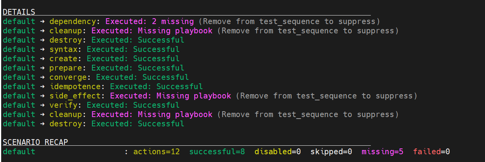
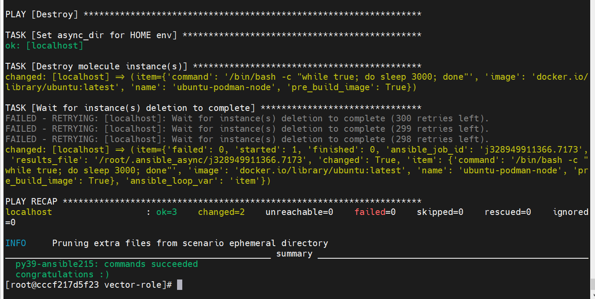
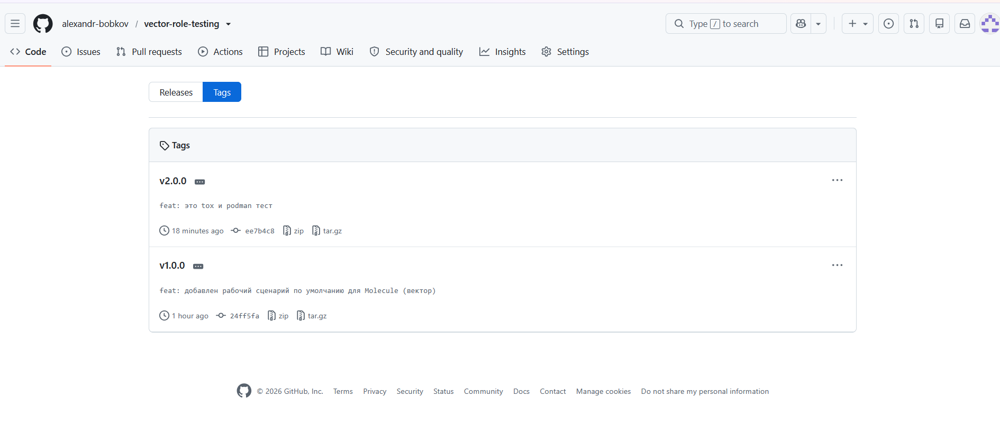

<b>Задание</b>

Домашнее задание к занятию 5 «Тестирование roles»
Подготовка к выполнению

    Установите molecule и его драйвера: pip3 install "molecule molecule_docker molecule_podman.
    Выполните docker pull aragast/netology:latest — это образ с podman, tox и несколькими пайтонами (3.7 и 3.9) внутри.

Основная часть

Ваша цель — настроить тестирование ваших ролей.

Задача — сделать сценарии тестирования для vector.

Ожидаемый результат — все сценарии успешно проходят тестирование ролей.
Molecule

    Запустите molecule test -s ubuntu_xenial (или с любым другим сценарием, не имеет значения) внутри корневой директории clickhouse-role, посмотрите на вывод команды. Данная команда может отработать с ошибками или не отработать вовсе, это нормально. Наша цель - посмотреть как другие в реальном мире используют молекулу И из чего может состоять сценарий тестирования.
    Перейдите в каталог с ролью vector-role и создайте сценарий тестирования по умолчанию при помощи molecule init scenario --driver-name docker.
    Добавьте несколько разных дистрибутивов (oraclelinux:8, ubuntu:latest) для инстансов и протестируйте роль, исправьте найденные ошибки, если они есть.
    Добавьте несколько assert в verify.yml-файл для проверки работоспособности vector-role (проверка, что конфиг валидный, проверка успешности запуска и др.).
    Запустите тестирование роли повторно и проверьте, что оно прошло успешно.
    Добавьте новый тег на коммит с рабочим сценарием в соответствии с семантическим версионированием.

Tox

    Добавьте в директорию с vector-role файлы из директории.
    Запустите docker run --privileged=True -v <path_to_repo>:/opt/vector-role -w /opt/vector-role -it aragast/netology:latest /bin/bash, где path_to_repo — путь до корня репозитория с vector-role на вашей файловой системе.
    Внутри контейнера выполните команду tox, посмотрите на вывод.
    Создайте облегчённый сценарий для molecule с драйвером molecule_podman. Проверьте его на исполнимость.
    Пропишите правильную команду в tox.ini, чтобы запускался облегчённый сценарий.
    Запустите команду tox. Убедитесь, что всё отработало успешно.
    Добавьте новый тег на коммит с рабочим сценарием в соответствии с семантическим версионированием.

После выполнения у вас должно получится два сценария molecule и один tox.ini файл в репозитории. Не забудьте указать в ответе теги решений Tox и Molecule заданий. В качестве решения пришлите ссылку на ваш репозиторий и скриншоты этапов выполнения задания.

-----
-----

<b>Ответ</b>

## Поддерживаемые ОС
Роль протестирована и поддерживает следующие операционные системы:
- **Ubuntu / Debian** (установка через локальный `.deb` пакет)
- **Oracle Linux 8 / RedHat** (установка через локальный `.rpm` пакет)

## Описание работы
Роль выполняет следующие задачи:
1. Создает необходимые директории для конфигурации (`/etc/vector`) и данных (`/var/lib/vector`).
2. Скачивает дистрибутив Vector (версия `0.35.0`) напрямую с официального репозитория GitHub.
3. Устанавливает пакеты без необходимости добавления внешних apt/yum репозиториев (защита от сбоев кэша).
4. Генерирует базовый конфигурационный файл `vector.toml` из Jinja2-шаблона.

## Требования для запуска и тестирования
- **Ansible**: `2.15.*`
- **Docker** (для сценария `default`)
- **Podman** (для сценария `podman`)
- **Molecule**: `6.0.3`
- **Tox**: `3.25+`

- Сценарий Default (Docker)
Проверяет кросс-платформенную установку на ubuntu:latest и oraclelinux:8
> 📸 ** Выполнение molecule test:** 📸
> 

- Сценарий Podman (Tox)
Облегченный сценарий тестирования в изолированном окружении Podman (через crun) для Ubuntu с использованием Tox.
> 📸 ** Выполнение Tox:** 📸
> 

- Для удобства две части задания разнесены по тегам
> 📸 ** Теги в github:** 📸
> 

-----
-----
